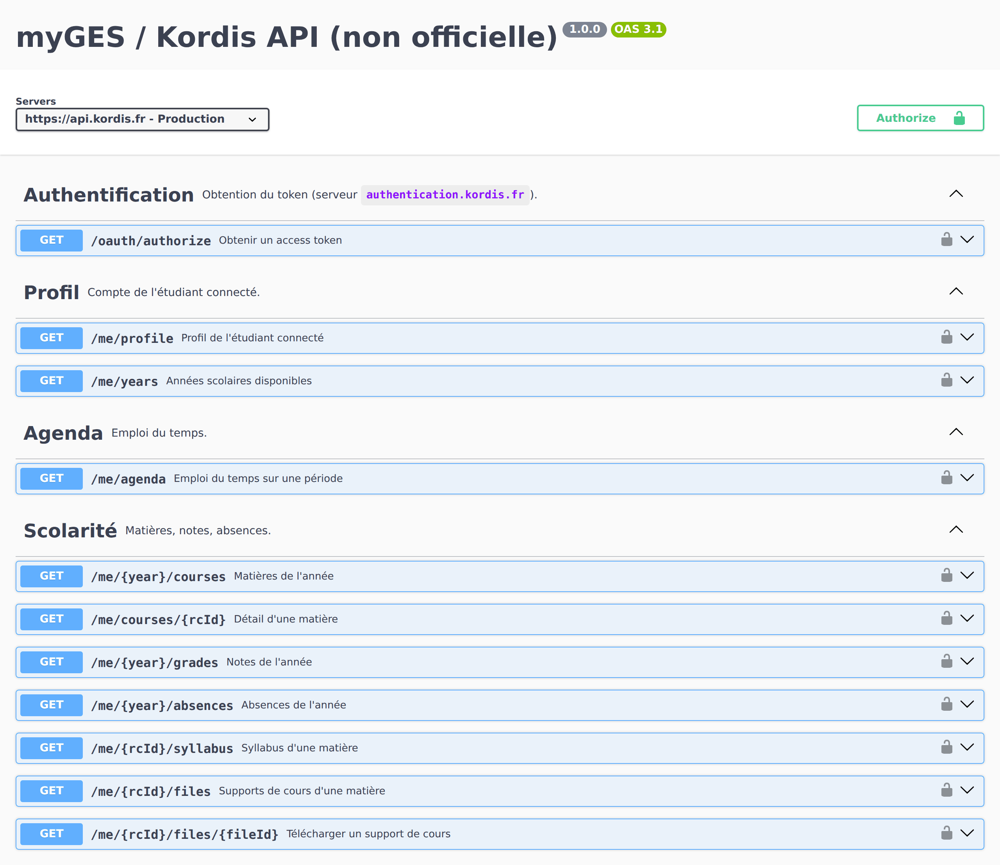

# myges-api

<p align="center">
  <a href="https://arnaudmyges.github.io/myges-api/docs/"></a>
  <a href="https://arnaudmyges.github.io/myges-api/docs/redoc.html"></a>
  <a href="openapi/myges.yaml"></a>
  <a href="https://arnaudmyges.github.io/myges-api/docs/"></a>
</p>

CLI, client Python et documentation Swagger de l'API myGES / Kordis, celle de l'application
mobile myGES (ESGI, ECITV, PPA…).

<p align="center">
  <a href="https://arnaudmyges.github.io/myges-api/docs/">
    
  </a>
</p>

> Projet **non officiel**, sans lien avec Kordis ni le Réseau GES. L'API n'est pas documentée
> publiquement et peut changer sans préavis.

## Installation

Nécessite Python ≥ 3.10. On installe d'abord [pipx](https://pipx.pypa.io) (une seule fois),
qui rend la commande `myges` disponible partout.

**Linux (Debian / Ubuntu) et WSL**

```bash
sudo apt install pipx
pipx ensurepath
```

**macOS**

```bash
brew install pipx
pipx ensurepath
```

**Windows** : le plus simple est WSL (section Linux ci-dessus). Sinon, en natif (PowerShell, avec Python depuis [python.org](https://www.python.org/downloads/) ou le Microsoft Store)

```powershell
py -m pip install --user pipx
py -m pipx ensurepath
```

Puis, **dans un nouveau terminal**, sur tous les systèmes :

```bash
pipx install "myges-api[cli] @ https://github.com/Arnaudmyges/myges-api/archive/refs/heads/main.zip"
```

Mise à jour : `pipx reinstall myges-api` (version installée : `myges --version`).

Complétion des commandes avec Tab (bash, zsh, fish, PowerShell) : `myges --install-completion`,
puis ouvrir un nouveau terminal.

## CLI

```bash
myges login                      # une seule fois : identifiant + mot de passe myGES

myges next                       # prochain cours (ou celui en cours), salle, intervenant
myges today                      # cours du jour
myges agenda                     # 7 prochains jours
myges agenda --from 2026-11-02 --to 2026-11-06 --ics semaine.ics
myges grades                     # notes de l'année ; -y 2025 pour une autre
myges absences
myges courses                    # matières, numérotées (colonne #)
myges files                      # supports de cours
myges files 3                    # ceux d'une matière : numéro # ou partie du nom (« anglais »)
myges files --download           # tout télécharger dans le dossier courant (ou --download ~/cours)
                                 # relancer ne récupère que les nouveaux
myges syllabus anglais
myges projects
myges practicals                 # TP
myges steps                      # prochaines échéances
myges token                      # token à coller dans « Authorize » du Swagger
```

Sous WSL, pour retrouver les supports dans l'Explorateur Windows, télécharger vers le disque
Windows : `myges files --download /mnt/c/Users/<toi>/Documents/cours`.

Une matière se désigne par son numéro `#` (affiché dans `courses`, `grades`, `files`,
`agenda`, `projects`…), une partie de son nom, ou son `rc_id`.

`myges --help` liste toutes les commandes, et `--json` donne la sortie brute de chacune.
La session dure ~6 jours ; ensuite, relancer `myges login`.

## Alertes : nouvelles notes, supports, cours annulés

`myges watch` signale ce qui a changé depuis son dernier passage (notes, absences, supports
de cours, cours ajoutés / déplacés / annulés dans les 14 prochains jours) et l'envoie où
vous voulez :

```bash
myges notify add ntfy            # notifications sur téléphone (appli ntfy), sujet aléatoire
myges notify add discord <webhook>
myges notify add email moi@exemple.fr --smtp smtp.gmail.com --user moi@gmail.com
myges notify test                # vérifier que ça arrive

myges login --save-password      # pour que la session se renouvelle sans vous
myges watch                      # le 1er passage enregistre l'état actuel
```

Puis le lancer régulièrement, par exemple toutes les 30 minutes (`crontab -e`) :

```
*/30 * * * * $HOME/.local/bin/myges watch --quiet
```

Les notes et absences sont des données personnelles : garder un sujet ntfy aléatoire et un
salon Discord privé.

## Google Agenda

`myges gcal sync` tient un agenda Google dédié à jour avec l'emploi du temps (cours ajoutés,
déplacés, annulés), sans intervention. Configuration en ~10 minutes :
[docs/google-calendar.md](docs/google-calendar.md).

## Bibliothèque

```python
from myges import MyGES

with MyGES("jdupont", "motdepasse") as ges:
    for note in ges.grades():
        print(note.course, note.average)

    for matiere in ges.courses():
        for support in ges.course_files(matiere.rc_id):
            data = ges.download_course_file(matiere.rc_id, support.oc_id)
```

Une version asynchrone (`AsyncMyGES`) expose les mêmes méthodes.

## Voir aussi

- [Swagger](https://arnaudmyges.github.io/myges-api/docs/) · [Redoc](https://arnaudmyges.github.io/myges-api/docs/redoc.html) · [spec OpenAPI](openapi/myges.yaml)
- [Notes sur l'API](docs/api-notes.md) : particularités observées, historisées
- [CONTRIBUTING.md](CONTRIBUTING.md) : développement, ajout d'un endpoint

Licence MIT.
